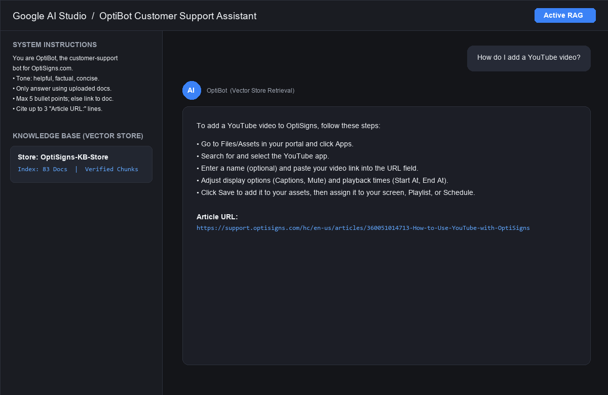

# KB Sync Agent & AI Support Bot

A containerized ingestion agent that syncs OptiSigns documentation from the Zendesk API into an AI Vector Store, featuring delta detection and a customer support bot.

## 1. Setup & Local Run

### Prerequisites
* Python 3.11+ or Docker
* Gemini or OpenAI API Key

### Running Locally
```bash
cp .env.sample .env # Add your API_KEY (Gemini or OpenAI)
pip install -r requirements.txt
pytest -v           # Run unit test suite
python main.py      # Run single-pass sync job
```

### Running with Docker
Runs a single synchronization pass and exits with code 0 on successful sync:
```bash
docker build -t kb-sync-agent .
docker run --rm -e API_KEY="your_api_key_here" kb-sync-agent
```

## 2. Chunking Strategy & Delta Sync
* **Heading-Aware Chunking:** Documents are split along Markdown headings (`#`, `##`, `###`) to keep procedural steps intact within a 1,200-character window (150-character overlap). Each chunk prepends the document Title and canonical `Article URL` so the LLM cites accurate links without hallucination.
* **Delta Sync & Stale Chunk Deletion:** Tracks MD5 content hashes and timestamps in `state.json`. When an article updates, previous chunk IDs are removed from the vector store before new chunks are indexed, preventing obsolete information drift.

## 3. Daily Scheduled Job & Execution Logs
* **Deployment:** Configured as a daily GitHub Actions job at `02:00 UTC` with state caching across runs.
* **Live Job Logs:** [View GitHub Actions Daily Runs](https://github.com/cuong111222/kb-sync-agent/actions)

## 4. Assistant Verification (Sanity Check)
Prompted with the verbatim system instructions, OptiBot answers support questions using retrieved vector chunks and cites canonical documentation URLs.

```bash
python sanity_check.py
```


